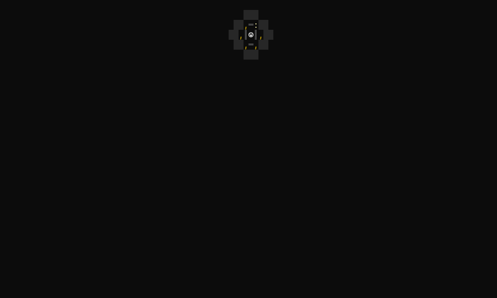
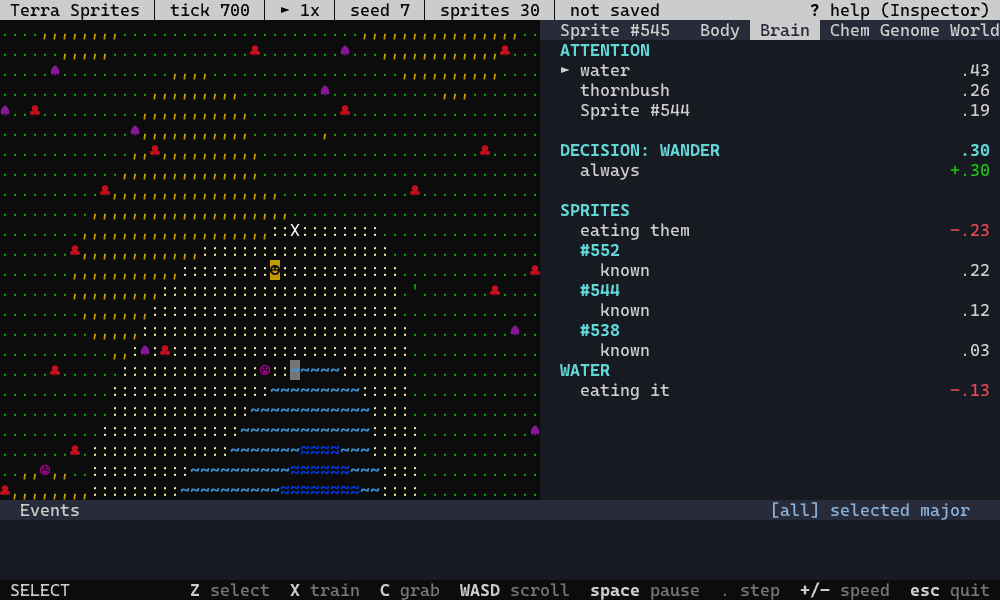

# Terra Sprites

A terminal terrarium of little creatures that live, learn and breed on their own. Inspired by *Creatures*.



Every sprite hatches with genes from its parents, a body that runs on chemistry and a brain that learns from experience. You don't control them. You watch, and when you feel like it you reach in: pet one for something you like, zap it for something you don't, hand it a berry, or lead it somewhere else. Then see what it makes of that. Eventually it grows old and its kids carry on, each generation a bit different from the last.

Some things that can happen while you watch:

- A sprite tries to eat a thornbush and gets pricked. The log says it learned "thornbushes are bad", and it stops going near them.
- A youngster watches its mom drink and figures out that water is for when you're thirsty.
- A sprite that gets hit becomes wary of whoever hit it, but not of everyone else.
- Pet a sprite each time it kicks a ball, and it starts kicking balls more often.



That's sprite #544 in seed 7, with its Brain tab open on the right. Once it learns that thornbushes hurt, the thornbush drops off the list of things it's paying attention to.

## Same seed, same world

A sprite's life has plenty of luck in it, but all of that luck comes from the seed. Start seed 7, keep your hands off, and you'll see the exact same story every time, on Windows, Mac or Linux. Do one thing differently and the story branches. Your last session is always saved as a replay, so you can watch it again, or jump in partway and take it somewhere new.

CI holds the game to that: on every change, four kinds of computer run the same world, and they have to end up in exactly the same state.

## Try it

It's best in a terminal of 100×30 or more (on Windows, Windows Terminal), and plays on a smaller one too. Download the game for Windows, Mac (Apple silicon) or Linux from the [v0.2.0 release](https://github.com/Keazra/terra-sprites/releases/tag/v0.2.0), with no Rust needed: the zip's `README.txt` says how to run it. Or, with [Rust](https://rustup.rs) 1.97.1 or newer:

```bash
cargo install --git https://github.com/Keazra/terra-sprites --tag v0.2.0 --locked terra-tui
terra-sprites
```

Leave out `--tag v0.2.0` to install the newest work in progress instead. To update, run it again with a newer release's tag, or `cargo uninstall terra-tui` to remove it (your saves stay until you delete them; the manual's [Uninstalling](docs/manual.md#uninstalling) says where). On the title screen, pick **New world**, and then:

- Click a sprite (`☺`) to select it, and press `]` for its Brain tab: what it's paying attention to, and why.
- `space` pauses and `+` speeds up. Lives are long at 1×, so try 4×.
- `X` is Train mode: click a sprite to pet it, right-click to zap it.
- `C` is Grab mode: pick up a berry (`•`) and put it down beside a hungry sprite.
- `?` shows every key.

`terra-sprites --seed 7` goes straight into seed 7's world. The [manual](docs/manual.md) has every key and flag, saves and replays, fast-forwarding a world through dozens of generations, and making clips like the ones above.

## Make it your own

The ground, the plants and toys, a sprite's body and instincts, and how the map is drawn are all plain data files you can edit. The [data-format reference](docs/reference/README.md) explains each one, with a working example.

## Where it's going

Milestone 1, *A Sprite Lives*, and milestone 2, *Generations*, are done, and v0.2.0 is the second's release. Next come bodies (limbs that let sprites grab, push, pull and carry things), then the terrarium turns out to be a ship, then a wilder world, and one day words. The [road map](https://claude.ai/artifact/8bcCKraEa32we24zPw4Fhe) shows every step and how far along it is, the manual's [roadmap](docs/manual.md#roadmap) has the short list, and the [designs](docs/design/) have the details.

Curious what goes on inside a sprite? [How a sprite lives](https://claude.ai/artifact/GyyEVVjN6TbKhPASDFwRmy) walks through it.

## How it's made

Fauxpaw designs the game, and [Claude Code](https://claude.com/claude-code) writes the code. It's Rust, with [ratatui](https://ratatui.rs) for the terminal.

## Licence

Free, under your choice of the [MIT licence](LICENSE-MIT) or the [Apache License 2.0](LICENSE-APACHE).
